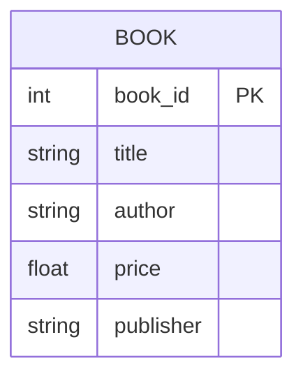
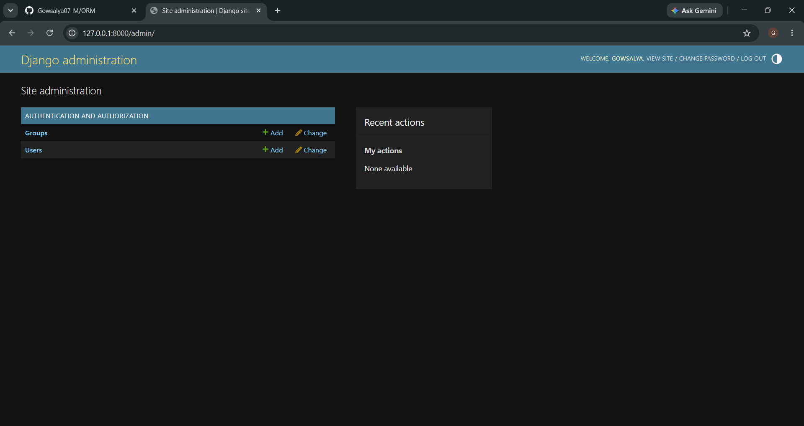

# Ex02 Django ORM Web Application
## Date: 06-11-2026

## AIM
To develop a Django Application to store and retrieve data from a E-Commerce Website Database for Amazon or Flipkart using Object Relational Mapping(ORM).


## ENTITY RELATIONSHIP DIAGRAM



## DESIGN STEPS

### STEP 1:
Clone the problem from GitHub

### STEP 2:
Create a new app in Django project

### STEP 3:
Enter the code for admin.py and models.py

### STEP 4:
Execute Django admin and create details for 10 books

## PROGRAM

### models.py
from django.db import models

class Book(models.Model):
    book_id = models.AutoField(primary_key=True)
    title = models.CharField(max_length=100)
    author = models.CharField(max_length=100)
    price = models.FloatField()
    publisher = models.CharField(max_length=100)

    def __str__(self):
        return self.title
### admin.py
```python
from django.contrib import admin
from .models import Book

admin.site.register(Book)


## OUTPUT
### Django Admin Page


## RESULT
Thus the program for creating E-commerce website database using ORM hass been executed 